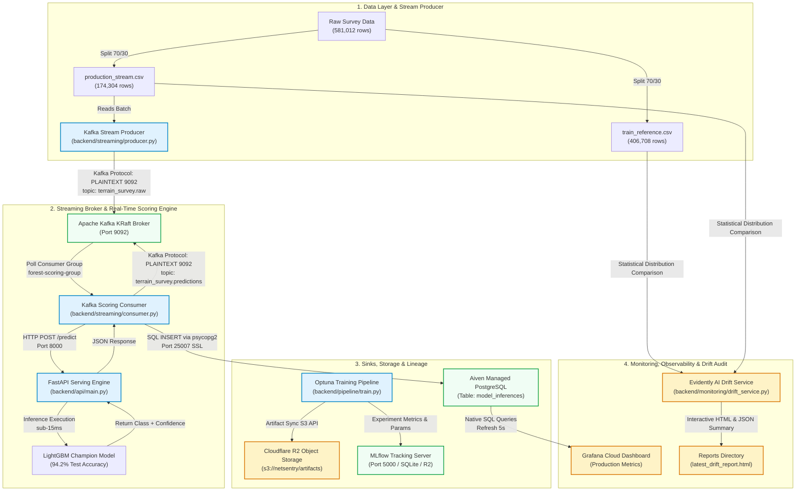

# Forest Cover Type MLOps Platform — Technical Architecture Guide

[](https://github.com/dipk6545/forest_cover_mlops/actions)
[](https://www.python.org/)
[](https://lightgbm.readthedocs.io/)
[](https://charmingjuniper1515.grafana.net)
[](LICENSE)

---

## 1. Executive Summary & Problem Statement

### 1.1 The Operational Challenge
Predicting forest cover type is an essential environmental and resource management capability across national forest wilderness areas. This platform solves the multiclass classification problem of identifying **7 distinct tree species** (Spruce/Fir, Lodgepole Pine, Ponderosa Pine, Cottonwood/Willow, Aspen, Douglas-fir, and Krummholz) strictly from **54 cartographic and geological variables** across **581,012 observation records** from the Roosevelt National Forest of northern Colorado.

Geological variables include high-dimensional continuous features such as elevation, slope, aspect, horizontal and vertical distances to hydrological features, hillshade variance (morning, noon, afternoon), and distances to critical infrastructure (fire points and roadways), alongside 4 wilderness areas and 40 distinct soil type classifications.

### 1.2 Core Business & Engineering Objectives
1. **Low-Latency Real-Time Scoring**: Deliver sub-15ms inference latency per survey point over high-throughput event streams.
2. **Decoupled Event-Driven Streaming**: Decouple geological data generators from ML scoring services via an event bus (Apache Kafka KRaft).
3. **Reproducible Experimentation & Lineage**: Full model provenance, metrics logging, and artifact synchronization via MLflow backed by Cloudflare R2 object storage.
4. **Cloud-Native Real-Time Observability**: Centralize telemetry into hosted Grafana Cloud connected directly to an Aiven PostgreSQL storage sink.
5. **Statistical Data Drift Detection**: Automatically compute Wasserstein distances and Kolmogorov-Smirnov (KS) tests via Evidently AI to detect micro-climate shifts and domain drift before accuracy decays.

---

## 2. End-to-End System Architecture

### 2.1 Complete Architecture Diagram
The architecture is partitioned into four synchronized layers: Ingestion, Serving, Storage/Tracking, and Production Observability.



---

## 3. Technology Stack Breakdown

| Category | Component / Library | Exact Version | Protocol / Port | Primary Role & Description |
| :--- | :--- | :--- | :--- | :--- |
| **Ingestion** | Confluent Kafka Python | `2.3.0` | Socket TCP (`9092`) | High-throughput streaming serialization and partition dispatch. |
| **Broker** | Confluent Kafka (KRaft) | `7.5.0` (Docker) | `PLAINTEXT://localhost:9092` | Distributed message log without ZooKeeper dependency. |
| **Model** | LightGBM | `4.3.0` | Native C++ bindings | Multiclass tree classifier optimized with 71 leaves and depth controls. |
| **Hyperparameter Tuning**| Optuna | `3.6.0` | Python API | Bayesian Tree-structured Parzen Estimator (TPE) sampler. |
| **Serving API** | FastAPI + Uvicorn | `0.110.0` / `0.28.0` | HTTP/REST (`8000`) | Non-blocking ASGI engine serving `/predict` with Pydantic validation. |
| **Experiment Registry** | MLflow | `2.11.1` (Docker) | HTTP (`5000`) | Metric logging, trial lineage, and production model registration. |
| **Cloud Storage** | Cloudflare R2 | S3-Compatible API | HTTPS (`443`) | Zero-egress S3-compatible bucket for models, transformers, and DVC. |
| **Relational Database** | Aiven PostgreSQL | PostgreSQL `15` | TLS/SSL (`25007`) | Hosted persistence sink for live scored events (`model_inferences`). |
| **Live Observability** | Hosted Grafana Cloud | Cloud SaaS | HTTPS (`443`) | SQL-driven telemetry panels for throughput, p95 latency, and class mix. |
| **Drift Monitoring** | Evidently AI | `0.4.21` | In-memory / HTML | Continuous data drift, Wasserstein distance, and KS testing. |
| **Containerization** | Docker Engine & Compose | Engine `24.0+` | Virtual Bridge Net | Clean 3-container local footprint (`kafka`, `api`, `mlflow`). |
| **CI/CD Automation** | GitHub Actions | Ubuntu 22.04 | Runner Agent | Docker image compilation and GHCR image publishing on commit. |

---

## 4. Detailed Component Lifecycle

### 4.1 Ingestion & Buffering Mechanisms
- **Batching & Frequency**: The producer reads from `data/processed/production_stream.csv` and serializes records into standard JSON envelopes. Events are emitted with configurable batch sizes (default: 50 to 500 records) and delay intervals (default: 0.05s to 0.2s).
- **Partitioning & Backpressure**: Events route into the single-partition Kafka topic `terrain_survey.raw`. Delivery callbacks inspect ACK flags from the broker. Every 10 records, `producer.flush(timeout=1.0)` is invoked to prevent internal buffer starvation.
- **Consumer Recovery**: The background consumer uses `group.id: forest-scoring-group` with `auto.offset.reset: earliest` and `enable.auto.commit: True`. If the scoring API returns a non-200 code or network drop, the consumer catches the exception, logs error details, and continues without tearing down the consumer thread.

### 4.2 Storage & Partitioning Patterns
- **Dataset Partitioning (70/30 Split)**:
  - `data/processed/train_reference.csv`: 406,708 rows. Immutable baseline representing historical forest survey data used for training and reference drift profiles.
  - `data/processed/production_stream.csv`: 174,304 rows. Isolated test split used exclusively to simulate live field telemetry through Kafka.
- **Remote Artifact Sync**:
  - Model weights (`lightgbm_champion.joblib`), scaler preprocessors (`preprocessor.joblib`), and training reports are synchronized directly to Cloudflare R2 (`s3://netsentry/forest-cover-mlops/artifacts/`) via boto3.
- **Database Schema**:
  The Aiven PostgreSQL instance automatically provisions the `model_inferences` table on consumer boot:
  ```sql
  CREATE TABLE IF NOT EXISTS model_inferences (
      id SERIAL PRIMARY KEY,
      timestamp TIMESTAMPTZ DEFAULT NOW(),
      elevation INT,
      predicted_class INT,
      tree_species TEXT,
      confidence FLOAT,
      latency_ms FLOAT
  );
  ```

### 4.3 Data Transformation & Feature Engineering
Raw cartographic survey records pass through feature engineering pipelines before scoring:
1. **3D Euclidean Distance to Hydrology**:
   $$\text{Euclidean\_Distance} = \sqrt{\text{Horizontal\_Distance\_To\_Hydrology}^2 + \text{Vertical\_Distance\_To\_Hydrology}^2}$$
2. **Hydrological Elevation Offset**:
   $$\text{Water\_Elevation} = \text{Elevation} - \text{Vertical\_Distance\_To\_Hydrology}$$
3. **Aspect Decomposition**: Converts cyclic compass degrees ($0^\circ - 360^\circ$) into trigonometric orthogonal vectors ($\sin(\text{Aspect})$ and $\cos(\text{Aspect})$) to eliminate boundary discontinuities.
4. **Hillshade Variance**: Mean and spread calculation of shade captured across 9:00 AM, 12:00 PM, and 3:00 PM sunlight angles.

### 4.4 Serving Layer Retention & Drift Governance
- **Rolling Inference Sink**: Live inference records in Aiven PostgreSQL provide sub-minute telemetry for Grafana Cloud. A 30-day rolling window retains granular row-level data for audit, while summary aggregations can be rolled up for historical reporting.
- **Evidently AI Drift Audit**: Run on-demand or on a cron cycle. Baseline reference data is compared against sliding windows of production stream data. Any continuous feature demonstrating a drift score exceeding the threshold ($p < 0.05$ or Wasserstein distance $> 0.1$) flags a drift alert in `backend/monitoring/reports/latest_drift_report.html`.

---

## 5. Engineering Log & Troubleshooting Post-Mortem

During the design, migration, and implementation of this platform, several critical engineering hurdles were diagnosed and resolved:

### Incident 1: Arize Cloud Tabular Feature Depreciation
- **Symptom**: Integration with Arize Cloud resulted in an empty dashboard with status `ml_models_enabled: False`.
- **Root Cause**: Arize updated their free tier policy to disable classic tabular ML model monitoring, restricting free tier access exclusively to LLM tracing.
- **Resolution**: Deprecated Arize and local Phoenix containers. Re-architected observability to use **Grafana Cloud** with an Aiven PostgreSQL storage sink, matching industry-standard SQL-driven analytics with zero licensing restrictions.

### Incident 2: Port Exhaustion & Codespaces Forwarding Clutter
- **Symptom**: Codespaces reported 4-5 local forward ports (Prometheus 9090, local Grafana 3000, Phoenix 6006, MLflow 5000, API 8000), causing port binding collisions and memory starvation in the browser IDE.
- **Root Cause**: Redundant monitoring containers were running locally alongside cloud counterparts.
- **Resolution**: Pruned `docker-compose.yml` down to exactly **3 essential containers**: `kafka` (9092), `api` (8000), and `mlflow` (5000). All telemetry dashboards were externalized to hosted Grafana Cloud.

### Incident 3: Kafka Partition Assignment Lag & Race Condition
- **Symptom**: `./run_stream.sh` triggered an error: `Subscribed topic not available: terrain_survey.raw: Broker: Unknown topic or partition`.
- **Root Cause**: The streaming producer pushed records before the newly started consumer completed its initial cluster handshake and group partition assignment.
- **Resolution**: Pre-created Kafka topics explicitly via `kafka-topics.sh` in the bootstrap script and added a 3-second warm-up interval (`sleep 3`) to allow consumer partition synchronization before producer dispatch.

### Incident 4: Python Consumer Environment Variable Isolation
- **Symptom**: Inferences were logged successfully to stdout, but Grafana Cloud displayed `0` total predictions and `No data`.
- **Root Cause**: When executing `python3 backend/streaming/consumer.py`, the child Python shell did not automatically inherit unexported variables from the `.env` file, leaving `MLFLOW_TRACKING_URI` empty and skipping the Aiven PostgreSQL insert block.
- **Resolution**: Integrated `python-dotenv` explicitly inside `consumer.py` (`load_dotenv()`) and committed the updated runner script to ensure database credentials load reliably across all environments.

### Incident 5: GitHub Push Protection on Hardcoded Connection Strings
- **Symptom**: Git rejected commits with: `Push rejected, found a sensitive value in backend/monitoring/grafana/datasource.yml`.
- **Root Cause**: Initial configuration had raw Aiven database passwords in plaintext YAML.
- **Resolution**: Removed hardcoded secrets, reset git history safely, parameterized datasources using `$__env{}` variable substitution, and configured automated Grafana Cloud provisioning via authenticated API service account tokens.
