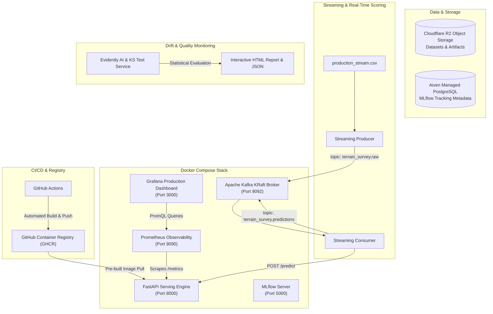

# 🌲 Forest Cover Type MLOps Platform — Operations & Run Guide

An end-to-end, enterprise-grade MLOps system featuring **FastAPI**, **Kafka (KRaft)**, **MLflow**, **Prometheus**, **Grafana**, **Evidently AI (KS Test)**, **Cloudflare R2**, and **GitHub Actions**.

---

## 🏗️ Architecture Overview



---

## 🌐 Active Service Ports & Web UIs

| Service | Port | Default URL / UI | Description |
| :--- | :--- | :--- | :--- |
| **Grafana Dashboard** | `3000` | `http://localhost:3000` | Real-time throughput, class donut chart, p95/p50 latency curves *(admin / admin)* |
| **FastAPI Swagger Docs** | `8000` | `http://localhost:8000/docs` | Interactive API documentation, `/predict`, `/predict_batch`, `/train` |
| **MLflow Server** | `5000` | `http://localhost:5000` | Optuna Bayesian hyperparameter study, metric comparisons, model registry |
| **Prometheus Server** | `9090` | `http://localhost:9090` | Time-series scraper, raw PromQL queries, targets status |
| **Kafka Broker** | `9092` | `localhost:9092` | KRaft event streaming broker (no ZooKeeper) |

---

## 🚀 Step-by-Step Operations & Commands

### 1. Initial Setup & Starting the Docker Stack
Pull the latest repository updates and start all containerized services:

```bash
# 1. Pull latest code
git pull origin main

# 2. Start all 5 container services in background
docker compose up -d

# 3. Verify container health status
docker compose ps
```

---

### 2. Retraining & Optuna Hyperparameter Tuning
To execute Bayesian optimization, train LightGBM, and log runs directly into MLflow:

```bash
# Run Optuna study (5 trials) & register champion model
python3 -m backend.pipeline.train --trials 5

# Or train baseline directly without Optuna
python3 -m backend.pipeline.train --no-optuna
```

> **UI Alternative:** You can also trigger training directly from the web by opening `http://localhost:8000/docs` and clicking **POST `/train` → Execute**.

---

### 3. Real-Time Kafka Streaming & Live Scoring
Stream production surveys through Kafka to test real-time model scoring and watch Grafana update live:

```bash
# Stream default batch of 50 events
./run_stream.sh

# Stream 500 events at high speed (0.05s delay)
./run_stream.sh 500 0.05

# Stream 2,000 events
./run_stream.sh 2000 0.02
```

---

### 4. Direct Single-Sample API Prediction (FastAPI)
Send a raw cartographic survey sample directly via HTTP POST:

```bash
curl -X POST "http://localhost:8000/predict" \
     -H "Content-Type: application/json" \
     -d @backend/artifacts/sample_input.json
```

**Expected JSON Response:**
```json
{
  "cover_type_id": 2,
  "tree_species": "Lodgepole Pine",
  "confidence": 0.8153,
  "latency_ms": 1.42
}
```

---

### 5. Running Data Drift & Kolmogorov-Smirnov (KS) Statistical Tests
Evaluate distribution drift between reference training baseline and production stream:

```bash
# 1. Run standalone Kolmogorov-Smirnov (KS) test on continuous features
python3 backend/monitoring/ks_test.py --samples 5000

# 2. Run KS test with injected elevation shift (+400m) to verify alert triggers
python3 backend/monitoring/ks_test.py --drift --samples 5000

# 3. Generate interactive Evidently AI visual HTML report
python3 backend/monitoring/drift_service.py --samples 2000
```
> Generated report saved to: `backend/monitoring/reports/latest_drift_report.html`

---

### 6. Prometheus PromQL Cheat Sheet
Enter these expressions in the Prometheus UI (`http://localhost:9090`):

- **Total Successful Predictions:**
  ```promql
  sum(api_requests_total{status="200"})
  ```
- **Live Request Throughput Rate (req/sec):**
  ```promql
  rate(api_requests_total[1m])
  ```
- **Predictions Breakdown by Tree Species:**
  ```promql
  predictions_by_class_total
  ```
- **p95 Latency Curve (Seconds):**
  ```promql
  histogram_quantile(0.95, sum(rate(prediction_latency_seconds_bucket[5m])) by (le))
  ```

---

### 7. Container Lifecycle Management

```bash
# View live logs of a specific service
docker logs -f forest_api_server
docker logs -f forest_mlflow_server
docker logs -f forest_grafana

# Restart a service
docker compose restart api

# Stop all containers
docker compose down

# Stop and wipe container volumes
docker compose down -v
```
